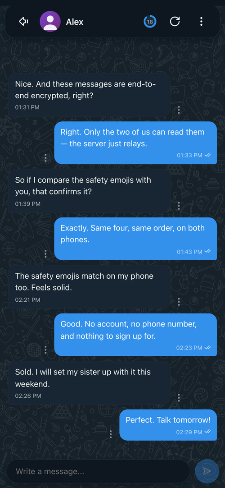
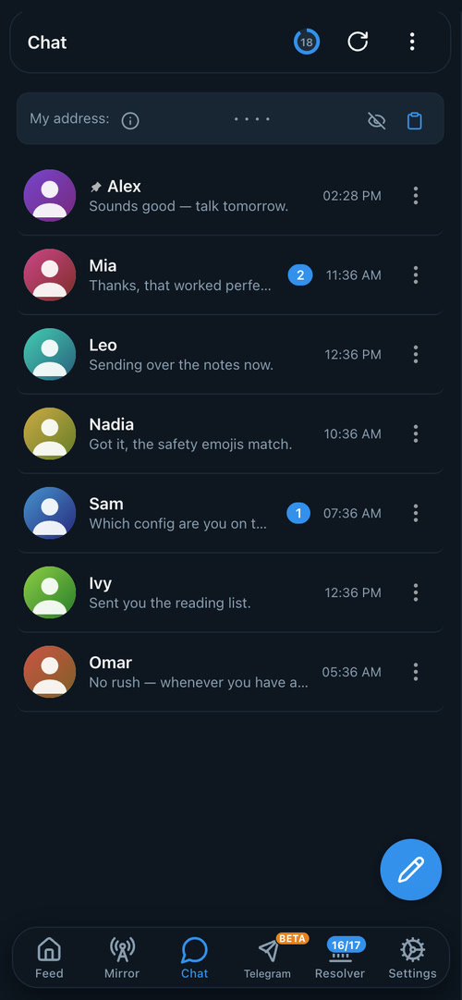
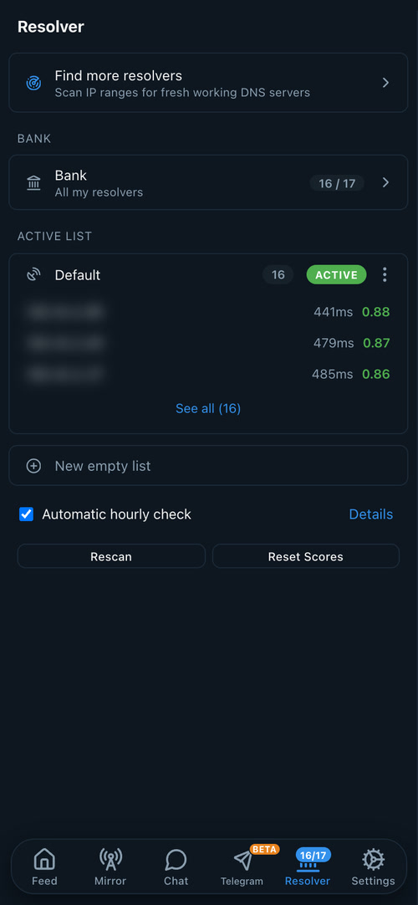
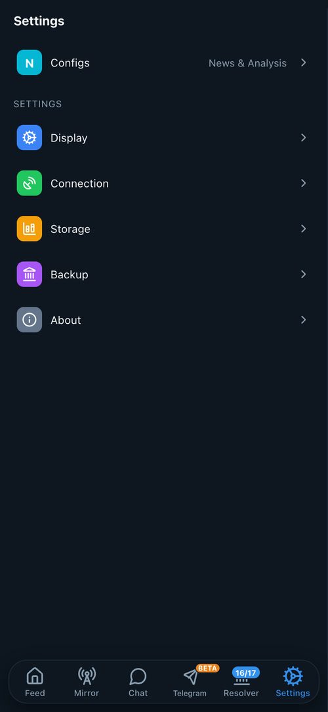

# thefeed

**基于 DNS 的消息流阅读器 + 轻量私信**，专为只有 DNS 能通过的网络设计。阅读 Telegram 频道和公开 X 账号，并与其他用户交换端到端加密消息 —— 全部走普通 DNS。

[English](README.md) · [فارسی](README-FA.md) · 简体中文 · [Русский](README-RU.md)

[](https://play.google.com/store/apps/details?id=com.thefeed.android)
[](https://testflight.apple.com/join/J6bfxDdZ)
[](https://github.com/sartoopjj/thefeed/releases/latest)

**目录：** [安装应用](#install-app) · [搭建服务器](#run-server) · [私信通道](#messenger) · [工作原理](#how-it-works) · [安全](#security) · [从源码构建](#build) · [参考](#reference) · [链接](#links)

## 截图

<table align="center">
<tr>
<td align="center"><br><sub>主信息流</sub></td>
<td align="center"><br><sub>阅读消息</sub></td>
<td align="center"><br><sub>Telemirror</sub></td>
<td align="center"><br><sub>私信</sub></td>
</tr>
<tr>
<td align="center"><br><sub>私信列表</sub></td>
<td align="center"><br><sub>解析器扫描</sub></td>
<td align="center"><br><sub>解析器池</sub></td>
<td align="center"><br><sub>设置</sub></td>
</tr>
</table>

---

<a id="install-app"></a>

## 安装应用

*只想阅读信息流和聊天的用户 —— 不需要自己搭服务器，导入一个配置即可。*

从最新版本下载对应平台的客户端 —— 选一个能访问的镜像：**[GitHub](https://github.com/sartoopjj/thefeed/releases/latest)** · **[GitLab](https://gitlab.com/sartoopjj/thefeed/-/releases)**。

| 平台 | 说明 |
|------|------|
| **Android**（7.0+） | 最简单：**[Google Play](https://play.google.com/store/apps/details?id=com.thefeed.android)** — 自动安装与更新。否则使用 APK。选 `arm64-v8a`（约 2017 年后的手机）或 `armeabi-v7a`（仅限老的 32 位机型）。装错架构会安装成功但无法运行。 |
| **iOS**（13+） | 通过 **[TestFlight](https://testflight.apple.com/join/J6bfxDdZ)** 安装。App Store 版本计划中；也可从 [ios/](ios/) 源码自行构建 —— 见 [从源码构建](#build)。 |
| **Windows**（10/11） | `.exe` **未签名**，因此 SmartScreen 会弹出 *"Windows protected your PC"*，Defender 可能会隔离它 —— 这是 DNS 隧道工具常见的**误报，并非恶意软件**。点 **More info → Run anyway**；若被删除，从 Defender → *Protection history* 恢复；不放心可核对发布页的 SHA-256。 |
| **macOS** | 通用 `.dmg`（Intel + Apple Silicon），拖动安装 `Thefeed.app`。未签名，首次启动请右键 → **Open**，或运行 `xattr -dr com.apple.quarantine /Applications/Thefeed.app`。 |
| **Linux / Termux** | `thefeed-client` 二进制 —— 运行后打开 `http://127.0.0.1:8080`。 |

然后打开 **设置 → 配置**，导入一个配置（或填入域名 + 口令）。DNS 解析器在 **解析器** 标签页管理 —— 一个所有配置共享的解析器池，外加一个用于发现更多解析器的扫描器。

**可用来测试的公开配置：** [@thefeedconfig](https://t.me/thefeedconfig)。

---

<a id="run-server"></a>

## 搭建服务器

*面向为他人托管信息流的运维者。* 服务器部署在**墙外**，从 Telegram / X 拉取内容，并响应加密的 DNS 查询。两步搞定：**（1）DNS 记录**，然后 **（2）安装**。

### 1. DNS 记录

需要一条 **A** 记录和一条 **NS** 委派。假设服务器 IP 为 `203.0.113.10`，域名为 `example.com`。

| # | Type | Name | Value | 用途 |
|---|------|------|-------|------|
| 1 | A  | `ns.example.com` | `203.0.113.10`   | 让一个主机名指向你的服务器 |
| 2 | NS | `t.example.com`  | `ns.example.com` | 将 **feed** 子域名委派给你的服务器 |
| 3 *（可选）* | NS | `c.example.com` | `ns.example.com` | 委派 **私信** 子域名 —— 仅当你启用 [私信](#messenger) 时 |

**1–2** 是信息流必需的。**3** 仅在启用可选的 [私信](#messenger) 时需要，且它必须用与 feed **不同**的子域名（如 `c.example.com`）。

### 2. 安装服务器

DNS 就绪后，用**脚本**或 **Docker** 安装。

#### 方案 A —— 安装脚本（Linux + systemd）

脚本会自动检测可用镜像（先 GitHub，后 GitLab）；加 `--gitlab` 强制走 GitLab。

```bash
# GitHub 镜像
sudo bash -c "$(curl -Ls https://raw.githubusercontent.com/sartoopjj/thefeed/main/scripts/install.sh)"

# GitLab 镜像（GitHub 账号不可用时）
sudo bash -c "$(curl -Ls https://gitlab.com/sartoopjj/thefeed/-/raw/main/scripts/install.sh)" -- --gitlab
```

脚本会下载最新二进制，询问你的域名 / 口令 / 频道 / X 账号，询问是否使用 Telegram 登录（推荐**否** —— 公开频道无需登录），并配置 systemd 服务。随时重跑即可**更新**。

其他操作：把参数加在同一条命令的末尾，前面单独加一个 `--`。这个 `--` 必不可少，否则 bash 会吞掉参数，脚本收不到。

```bash
# 例如：安装最新的预发布版
sudo bash -c "$(curl -Ls https://raw.githubusercontent.com/sartoopjj/thefeed/main/scripts/install.sh)" -- --pre
```

| Flag | 作用 |
|------|------|
| `--version v0.9.2`（或 `-v`） | 安装指定 tag（回滚） |
| `--pre` | 安装最新预发布（beta / rc） |
| `--list` | 列出近期版本 |
| `--login` | 重新进行 Telegram 登录 |
| `--config` | 打印导入 URI（域名、密钥、服务器公钥 `sk=`、引导解析器） |
| `--uninstall` | 卸载服务 |

#### 方案 B —— Docker

无需 Go 工具链。基础镜像 `alpine:3.21`（约 23 MB），以非 root 用户 `thefeed`（UID 1000）运行。

```bash
# 1. 配置 —— 设置 THEFEED_DOMAIN 和 THEFEED_KEY（需要私有频道时取消 Telegram 变量的注释）
cp .env.example .env && nano .env

# 2. 添加频道
mkdir -p data
cp configs/channels.txt data/
cp configs/x_accounts.txt data/   # 可选

# 3. 构建并运行（容器内监听 :5300/udp）
docker compose up -d
docker compose logs -f

# 4. 打印客户端导入配置（thefeed:// URI —— 域名、密钥、服务器公钥 sk=、解析器），像脚本结尾那样发给用户：
docker compose run --rm server --print-config --data-dir /data --domain YOUR_DOMAIN --key YOUR_KEY
```

然后完成下面的 [53 端口重定向](#port53)。私有频道需先做一次交互式登录：

```bash
docker compose run -it --rm server --login-only --data-dir /data \
  --domain YOUR_DOMAIN --key YOUR_KEY \
  --api-id YOUR_API_ID --api-hash YOUR_HASH --phone YOUR_PHONE
# 然后在 docker-compose.yml 中去掉 --no-telegram，加上 Telegram 参数，再 `docker compose up -d`
```

<a id="port53"></a>

### 53 端口

服务器必须在 UDP **53** 端口接收**外部** DNS，但直接绑定 `:53` 会与 `systemd-resolved` 冲突。所以它监听非特权端口（`:5300`），你用 `iptables` 把外部 `:53` 重定向过去。主机本地 DNS 不受影响 —— 只有到达外部网卡的包被重定向。

```bash
# 把 eth0 换成你的网卡（用 ip a 查看）
sudo iptables  -I INPUT -p udp --dport 5300 -j ACCEPT
sudo iptables  -t nat -I PREROUTING -i eth0 -p udp --dport 53 -j REDIRECT --to-ports 5300
sudo ip6tables -I INPUT -p udp --dport 5300 -j ACCEPT
sudo ip6tables -t nat -I PREROUTING -i eth0 -p udp --dport 53 -j REDIRECT --to-ports 5300

# 重启后仍生效（Debian/Ubuntu）
sudo apt install -y iptables-persistent && sudo netfilter-persistent save
```

出问题时**立即撤销**：

```bash
sudo iptables -t nat -D PREROUTING -i eth0 -p udp --dport 53 -j REDIRECT --to-ports 5300
sudo iptables -D INPUT -p udp --dport 5300 -j ACCEPT
sudo netfilter-persistent save
```

快速检查：`ss -ulnp | grep ':53 '`（应只有 `systemd-resolved` 在 `127.0.0.53`）、`dig +short google.com @127.0.0.53`（本地 DNS 仍工作）、`iptables -t nat -L PREROUTING -n | grep 5300`（重定向生效）。

### 服务管理

```bash
systemctl status thefeed-server
systemctl restart thefeed-server
journalctl -u thefeed-server -f

sudo vi /opt/thefeed/data/channels.txt   # 编辑频道，然后：
sudo systemctl restart thefeed-server
```

服务器还能从每小时报告（`<data-dir>/dns_hourly.jsonl`）渲染一个终端仪表板 —— 不在网络上提供任何服务，只读数据目录：

```bash
thefeed-server --data-dir /srv/thefeed --report                   # 快照
thefeed-server --data-dir /srv/thefeed --report --report-refresh 5s   # 实时
```

它显示总查询数（频道抓取 / 元数据 / 媒体 / 私信）、每频道与各域名的聚合，以及私信统计。

<a id="server-flags"></a>

### 服务器参数

关键参数（也可用环境变量设置，如 `THEFEED_DOMAIN`、`THEFEED_KEY`）：

| Flag | Default | 说明 |
|------|---------|------|
| `--data-dir` | `./data` | 数据目录（频道、session、缓存、配置） |
| `--domain` | | DNS feed 域名 **（必填）** |
| `--key` | | 加密口令 **（必填）** |
| `--extra-domains` | | 逗号分隔的额外 feed 子域名（分担负载 + 容灾） |
| `--chat-domains` | | 在这些子域名上启用 [私信](#messenger)（与 feed 分开） |
| `--mtproto-domains` | | 在这些子域名上启用 [DNS 上的 Telegram](#telegram-over-dns)（与 feed 和私信分开） |
| `--no-telegram` | `false` | 不登录 Telegram（仅公开频道） |
| `--api-id` / `--api-hash` / `--phone` | | Telegram 凭据（私有频道） |
| `--login-only` | `false` | 登录 Telegram、保存 session、退出 |
| `--listen` | `:5300` | DNS 监听地址 |
| `--msg-limit` | `15` | 每频道抓取的最大消息数 |
| `--fetch-interval` | `10` | 抓取周期（分钟，最小 3） |
| `--allow-manage` | `false` | 允许远程发送 / 频道管理（非可信勿开） |
| `--padding` | `32` | 最大随机填充字节（抗 DPI；0 = 关闭） |
| `--x-rss-instances` | `nitter.net,…` | 逗号分隔的 X RSS 基址 —— 见下方警告 |
| `--dns-media-enabled` | `false` | 通过慢速 DNS 中继提供媒体 |
| `--github-relay-enabled` | `false` | 通过快速 GitHub 中继提供媒体（需 `--github-relay-token` / `-repo`） |
| `--report` | | 渲染终端仪表板后退出 |
| `--version` | | 显示版本后退出 |

> **⚠ X（Twitter）帖子目前无法使用。** X 内容通过 Nitter 抓取，而 Nitter 项目已被
> **归档**，其公共实例现在一律返回 "Instance has been rate limited"
> （[zedeus/nitter#1442](https://github.com/zedeus/nitter/issues/1442)）。在出现可用
> 来源之前，信息流的 X 部分不再更新。请把 `--x-rss-instances` 指向你确认仍可用的实例，
> 或者不使用 X。**仅影响服务端** —— Telegram 频道、Mirror、信使和所有客户端均不受影响。
>
> **自建 Nitter 仍然可行。** 已归档的代码依旧能跑：克隆仓库，用一个真实的 X 账号生成
> session 令牌（脚本和说明在 Nitter 仓库/wiki 里），用 Docker + Redis 运行，再把
> `--x-rss-instances` 指向它（例如 `http://127.0.0.1:8080` —— 只有 thefeed 服务端读取它，
> 无需域名和 TLS）。请保持实例**私有**：该项目正是因针对公共实例的法律压力而归档的。

完整的媒体中继参数见 [工作原理 → 媒体中继](#media-relays)。

---

<a id="messenger"></a>

## 私信通道

一个**可选的**、独立的存储转发私信功能，用于同一服务器的用户之间 —— 与 Telegram 完全无关。为服务器配置一个或多个专用子域名（并添加对应的 [NS 记录](#run-server)，与 feed 域名分开）即可启用：

```bash
thefeed-server ... --chat-domains c.example.com     # 或 THEFEED_CHAT_DOMAINS=c.example.com
```

- **端到端加密** —— 只有双方能读消息；服务器仅存储不透明数据块，在不读取内容的情况下验证发送者。联系人名称永不离开设备。
- **身份** —— 客户端在本地生成恢复码；你的地址是由它派生的 20 个字符。通过其他渠道把地址告诉对方即可被联系；同一恢复码可在任何服务器上使用。
- **失败即关闭** —— 只有配置固定了服务器公钥（`sk=`）且服务器已签名的私信能力通过校验，客户端才启用私信。feed 元数据里的一个签名比特让无密钥的客户端提示「此服务器有私信 —— 请用其密钥重新导入配置」，而不是静默失败。
- **滥用限制**（自动告知客户端）：`--chat-send-per-hour`（30）、`--chat-inbox-cap`（50）、`--chat-per-pair-cap`（10）、`--chat-max-msg-bytes`（500）；未送达消息在 `--chat-ttl-hours`（72）后过期。`--chat-enabled=false` 保留域名但对外宣告私信停用。启用聊天时安装脚本会询问这些值，更新时会保留你手动设置的值。

在客户端从底部导航栏打开 **Chat**。✓ = 已存到服务器，✓✓ = 对方已取走；两台设备上的安全表情一致即表示会话安全。

### AI 助手桥接（Hermes）

[`integrations/hermes/`](integrations/hermes/) 让你通过私信通道与 [Hermes](https://github.com/NousResearch/hermes-agent) AI 智能体聊天，断网时也能联系到它。它是一个 Hermes 技能：把这个文件夹交给你的智能体，它会自行完成配置。它只读取来自你自己地址的消息；陌生人发来的消息既不会得到回复，也不会展示给模型。

请在**你自己的 thefeed 服务器**上运行它：桥接程序会全天候轮询，而应用内置的共享默认服务器是给人用的，不是给机器人用的。如果你没有自己的服务器，默认配置也可以使用。

---

<a id="telegram-over-dns"></a>

## DNS 上的 Telegram（测试版）

同一条隧道的**可选**第二种用途：登录**你自己的 Telegram 账号**，通过服务器使用它——不需要 VPN，也不需要代理应用。它的工作方式与通过 MTProto 代理使用 Telegram 一样，区别只在于传输层换成了 DNS，因此当一个国家的网络被收缩到只剩内网流量时依然可用。用专用子域名启用（需配套的 [NS 记录](#1-dns-records)，与订阅和私信域名分开）：

```bash
thefeed-server ... --mtproto-domains m.example.com   # 或 THEFEED_MTPROTO_DOMAINS=m.example.com
```

- **Telegram 自己的协议，未作改动** — MTProto 被封装进普通的 DNS 查询；服务器拆包后把字节转发到 Telegram 的数据中心。授权密钥在客户端生成且从不离开设备，所以中继只搬运密封的数据包，无法读取内容。
- **需要实现了该功能的服务器** — 普通的 MTProto 代理无法在 DNS 上承载 MTProto。thefeed 的服务器可以；客户端只会在选择列表中提供那些服务器已声明隧道（订阅元数据中的签名位）的配置。
- **支持的功能**：你的会话、群组、频道和机器人；收发文本；✓/✓✓ 已读标记；群内发送者名字；对已加载内容的搜索；用 @username 发起会话；退出频道或清空会话；未读计数。
- **不支持的功能**：下载图片、文件、贴纸和语音；通话；发送媒体；论坛话题（合并显示）；点击机器人的回调按钮（会列出来，链接按钮可用）。带附件的消息会显示**是什么**——图片、文件及其名称和大小、贴纸、语音——不会悄无声息地缺失。
- **刻意只传文本。** 每个字节都是一次 DNS 查询，所以客户端只获取新增内容，并保留已经拿到的部分。
- **速度由三项设置决定** —— 每秒查询数、超时时间，以及每个查询使用的解析器数量。第一项同时也是同时在途查询数的上限，因此发送窗口随设定速率变化，不会无限增长。消息自身的分帧会说明它需要多少次查询，于是这些查询一起发出，而不是每个往返只发一个；服务器则按任意到达顺序重新拼装。
- **中继无法管控内容** —— 数据流在你与 Telegram 之间端到端加密，服务器只看到不透明的字节，分不清消息和文件。它能限制的是流量：`--mtproto-down-kb-per-min`（默认每条隧道 512 KB/分钟）会拖慢任何试图拉取文件的客户端，`--mtproto-max-tunnels` 则限制并发数量。
- **通知**：应用打开时会响铃并提醒。应用退到后台时，可在 ⋮ 菜单中开启后台检查——它会持续消耗查询，因此默认关闭。
- **需要好的解析器。** 订阅和私信在极慢的解析器上表现好得多；这是整个应用中最吃带宽的部分。
- **应用凭据** — 在 [my.telegram.org](https://my.telegram.org) 申请你自己的 `api_id` / `api_hash`。如果 Telegram 停用了一对共享凭据，所有用它登录的人会同时被登出。
- **限制项**：`--mtproto-enabled`、`--mtproto-max-tunnels`、`--mtproto-idle-minutes`、`--mtproto-buffer-kb`、`--mtproto-dial-seconds`。

在客户端中，从底部导航打开 **Telegram**。⋮ 菜单在每个界面都有（配置选择、凭据、日志、退出登录）；✓ / ✓✓ 表示已发送和已读；标题栏的圆环倒计时显示下一次自动检查的时间，每个操作都会显示自己的进度和已消耗的查询数。

---

<a id="how-it-works"></a>

## 工作原理

```
                                  Encrypted DNS TXT
   ┌──────────────┐  feed meta + small media   ┌──────────────────┐    MTProto      ┌──────────┐
   │              │ ─────────────────────────▸ │      Server      │ ─────────────▸  │ Telegram │
   │    Client    │ ◂───────────────────────── │  (DNS auth +     │ ◂─────────────  │   API    │
   │  (Web UI)    │                            │   media relays)  │    RSS / HTTP   ┌──────────┐
   │              │  large media (fast relay)  │                  │ ─────────────▸  │  Nitter  │
   │              │ ◂───── api.github.com ◂──  │                  │ ◂─────────────  │ (X feed) │
   └──────────────┘     (uploaded by server)   └──────────────────┘                 └──────────┘
```

**服务器**（墙外）：连接 Telegram 读取配置的频道；通过兼容 RSS 的镜像抓取公开 X 帖子（无需登录）；把 feed 元数据和小文件作为**加密 DNS TXT** 响应提供，并加随机填充（抗 DPI）。登录一次、长期运行；`--no-telegram` 无凭据读取公开频道。可选的**多域名**与 **[私信](#messenger)** 模式。所有状态都在一个数据目录里。

**客户端**（墙内）：基于浏览器的 Web UI（RTL/波斯语，VazirMatn 字体），通过共享的**解析器池**发送加密 DNS 查询 —— 解析器可通过扫描器、导入或手动添加，并按成功率 + 延迟打分，优先用健康的。**散射模式**把一次查询发给多个解析器、取最快的应答。媒体下载感知中继并校验哈希/大小。内置 [私信](#messenger)、按频道自动更新、新消息提示、实时 DNS 查询日志。

### 协议

所有通信都用 AES-256 加密，承载在标准 DNS TXT 查询/响应上，配合可变填充和解析器评分，与正常 DNS 无异。消息数据在加密前先经 deflate 压缩；每次查询相互独立（链路上无会话状态）。

<a id="media-relays"></a>

### 媒体中继

带图片、文件、GIF、音频、视频的消息可在服务器缓存并经同一通道下载。服务端对每个文件去重（按上游 id + 内容哈希），把字节推送到所有已启用的中继，并在消息文本加一个小头部：

```
[IMAGE]<size>:<flags>:<dnsCh>:<dnsBlk>:<crc32>[:<filename>]
optional caption
```

`<flags>` 是逗号分隔的各中继可用性位（`1`=可用，`0`=不可用）：槽 0 = DNS，槽 1 = GitHub，未来中继向后追加；老客户端忽略不认识的槽。每个中继独立 —— 同一文件可同时经多条路径提供。客户端优先选最快的、失败重试、回退到更慢路径前先询问。每个 DNS 缓存文件的第 0 块以 16 字节头部（CRC32 + 版本 + 压缩字节 + 预留）开头，客户端在交付字节前校验它。下载在客户端（IndexedDB，7 天）和本地客户端（`<dataDir>/media-cache/`，7 天）缓存。

目前有两种中继：

- **DNS 中继**（慢、抗封锁、默认关闭）—— 字节拆分到 DNS 块。默认上限 100 KB。
- **GitHub 中继**（快、默认关闭）—— 字节上传到仓库，客户端走普通 HTTPS 拉取；需带 `contents:write` 的 PAT。文件落到 `<repo>/<sanitised-domain>/<size>_<crc32>`。默认上限 15 MB。

| Flag | Env | Default | Notes |
|------|-----|---------|-------|
| `--dns-media-enabled` | `THEFEED_DNS_MEDIA_ENABLED` | `false` | DNS 中继开关 |
| `--dns-media-max-size` | `THEFEED_DNS_MEDIA_MAX_SIZE_KB` | `100` KB | 单文件上限 |
| `--dns-media-compression` | `THEFEED_DNS_MEDIA_COMPRESSION` | `gzip` | `none` / `gzip` / `deflate` |
| `--github-relay-enabled` | `THEFEED_GITHUB_RELAY_ENABLED` | `false` | GitHub 中继开关 |
| `--github-relay-token` | `THEFEED_GITHUB_RELAY_TOKEN` | — | PAT，`contents:write` |
| `--github-relay-repo` | `THEFEED_GITHUB_RELAY_REPO` | — | `owner/repo` |
| `--github-relay-branch` | `THEFEED_GITHUB_RELAY_BRANCH` | `main` | 分支 |
| `--github-relay-max-size` | `THEFEED_GITHUB_RELAY_MAX_SIZE_KB` | `15360` KB | 单文件上限 |
| `--github-relay-quota-gb` | `THEFEED_GITHUB_RELAY_QUOTA_GB` | `100` GB | 仓库容量预算（用于告警） |

### ⚠ 中继仓库只会不断变大 —— 请留意其体积

中继对象以 git 提交的形式写入，而 **git 历史会保留每一个 blob**。TTL 清理只是把
文件从当前树中删除，并**不会**回收空间：仓库只会越来越大，直到 GitHub 以
`403 Repository is above its size quota` 拒绝推送（实测约 100 GB）。到那时中继既
无法上传也无法清理，`git push --force` 同样无济于事，因为 GitHub 不会按需执行垃圾
回收。

服务器会为你做的事：

- 每 30 分钟读取仓库体积，在达到 `--github-relay-quota-gb` 的 **70%** 和 **90%**
  时写入告警日志。
- 在 `thefeed-server --report` 的 **Media cache & relay** 一节显示仓库体积、剩余
  空间、队列长度与最近一次错误。
- 每个文件到达时立即上传，内存中只保留返回的对象 id，因此仓库写满或 GitHub 不可达时
  会退回 DNS 媒体路径，而不是内存一直增长直到进程被 OOM 杀死。

你需要做的事：**在 GitHub 上删除该仓库，再用同名重新创建。** 如果你的令牌是**细粒度**
令牌（`github_pat_…`）且只授权了这一个仓库，请在重建后到令牌设置里**重新授权该仓库**：
细粒度令牌绑定的是仓库 *ID*，重建会改变 ID，即使名称相同也会失去访问权限。经典
`ghp_…`（`repo` 权限）令牌不受影响。勾选 "Add a README" 也没关系
—— 两种情况下服务器都会发现自己的目录已不存在，重置其对象索引并按需重新上传，无需手动
清理状态。在中继为空期间，媒体仍可通过 DNS 获取。

请**每台服务器使用独立仓库**。两台服务器共用一个仓库是安全的（路径按域名的 HMAC
隔离，彼此无法删除对方的文件），但它们会争用同一分支，并共享同一容量预算。

---

<a id="security"></a>

## 安全

**两部分访问控制：**

- **加密口令（`--key`）** —— 服务器和客户端都需要。持有它的人能读取所有频道消息（含私有频道）；只分享给信任的人。
- **远程管理（`--allow-manage`）** —— 开启后，持有口令的人可从客户端：**用服务器端的 Telegram 账号发送消息**（发到频道 / 私聊 —— 这是通过运维者已登录的 Telegram 账号发送，与端到端 [私信](#messenger) **完全不同**），以及**修改信息流的频道列表**（增删信息流中显示的频道）。默认关闭；只在可信服务器上开启。
- **客户端 Web 密码（`--password`）** —— 对 Web UI 做 HTTP Basic Auth。仅本地保护；不影响 DNS 层访问。

**用你自己的名字访问客户端 Web UI。** 客户端只响应本机确实可达的地址 —— 回环地址、它绑定的地址，以及你自己列出的名字。其他一律以 `403` 拒绝，并在错误里点明要设置哪一项；否则，互联网上的某个页面只要把自己的域名解析到 `127.0.0.1`，在浏览器看来就与 UI 同源，便能读到你的口令。如果你通过 nginx 或自定义主机名提供客户端，请把它列出来：

```bash
THEFEED_EXTRA_HOSTS=feed.example.com,feed.home.lan
```

在 **Android 和 iOS** 上你不需要自己设置 `--password`：应用每次启动都会自己生成一个，并且只交给自己的 WebView，因此手机上的其他应用会拿到 `401` —— 即使应用正处于锁定状态，因为手机上的回环地址并不私密。无需任何配置。在 **Android** 上，设备可以设置密码，该密码还会包裹 Telegram 会话与消息缓存的密钥，使这些文件在没有密码时毫无用处。


**特性：** 双向端到端 AES-256 · 随机填充挫败大小分析 · 每次查询独立（链路上无会话状态）· 写操作受 `--allow-manage` 门控 · Telegram 两步验证交互式询问（绝不存进参数）· session 文件权限 `0600`。

> **⚠️ 切勿公开分享你的口令。** 任何持有者都能运行自己的客户端读取你的全部消息 —— 无法阻止。`--password` 仅保护你自己机器上的 Web UI。

可选的 [私信](#messenger) 按会话单独端到端加密，与 feed 口令相互独立。

---

<a id="build"></a>

## 从源码构建

**前置条件：** Go 1.26+，以及（私有频道所需的）来自 <https://my.telegram.org> 的 Telegram API 凭据。

```bash
make build          # 构建服务端 + 客户端到 ./build
make build-server   # 仅服务端
make build-client   # 仅客户端
make test           # 带竞态检测的测试
make build-all      # 交叉编译所有平台（含 Android）
make vet            # go vet
```

**运行服务器**（见 [参数](#server-flags)）：

```bash
./build/thefeed-server --data-dir ./data --domain t.example.com --key "passphrase" --no-telegram --listen ":5300"
# 私有频道：先用 --login-only 登录一次（配 --api-id/--api-hash/--phone），之后去掉再运行
```

**运行客户端：** `./build/thefeed-client`（创建 `./thefeeddata/`，打开 `http://127.0.0.1:8080`）。选项：`--data-dir`、`--port`（8080）、`--password`。各配置的选项（解析器、散射、限速、超时）在 Web UI 里设置，不走命令行参数。

**macOS：** `make mac-dmg` → `build/Thefeed.app` + 通用 `.dmg`。数据在 `~/Library/Application Support/Thefeed`；菜单栏项提供 **Open / Quit**。

**Android APK：**

```bash
make build-android-arm64
cp build/thefeed-client-android-arm64 android/app/src/main/assets/thefeed-client
cd android && gradle wrapper --gradle-version 8.10.2 && ./gradlew assembleDebug
# → android/app/build/outputs/apk/debug/app-debug.apk
```

**iOS：** 把 Go 客户端封装为 gomobile 绑定的 xcframework，由 `ios/` 下的 SwiftUI 应用使用。服务器在进程内以 `127.0.0.1:<random-port>` 运行，仅前台。需 Xcode 15+、Go 1.26+、gomobile（`go install golang.org/x/mobile/cmd/gomobile@latest && gomobile init`）。

```bash
make ios-bind    # 构建 Mobile.xcframework（真机 + 模拟器）
make ios-build   # 为模拟器构建应用
```

然后在 Xcode 打开 `ios/Thefeed.xcodeproj` 以在真机运行。

**发布：** 推送以 `v` 开头的 tag 触发 CI 构建 + 发布。含 `-` 的 tag（如 `v1.4.0-rc1`）自动标记为预发布。产物包含所有平台的服务端/客户端二进制以及 Android APK（`arm64-v8a`、`armeabi-v7a`）。

---

<a id="reference"></a>

## 参考

### 配置文件格式

均为可选，放在数据目录里；`#` 开头为注释，空行忽略。

- **`channels.txt`** —— 公开 Telegram 频道，每行一个 `@username`。
- **`x_accounts.txt`** —— 公开 X（推特）用户名，每行一个。
- **`private_channels.txt`** —— 私有频道邀请链接，每行一个。需要登录 Telegram —— 服务器启动时加入每个频道，之后像普通频道一样抓取。可接受：`https://t.me/+…`、`t.me/joinchat/…`、`tg://join?invite=…`，或纯邀请哈希。

```
# channels.txt      # x_accounts.txt    # private_channels.txt
@VahidOnline        Vahid               https://t.me/+aBcDeF123456
```

### Web UI

Telegram 风格外壳，**底部导航栏**分五个区：

- **Feed** —— 按类型（公开/X/私有）分组的频道/X 信息流、原生 RTL/波斯语渲染、悬浮输入框（连上 Telegram 时可发到频道/私聊）、每频道新消息角标、媒体标签高亮、频道内搜索、实时 DNS 日志。**保存的消息**（加密的本地笔记 + 书签）也在这里。
- **Mirror**（Telemirror）—— Telegram-web 风格的只读频道镜像，图片/相册按精确长宽比渲染，加载时不跳动。
- **Chat** —— 端到端加密的 [私信](#messenger)。
- **Resolver** —— 共享**池**、你命名的解析器**列表**、以及**扫描器**合为一处。扫描器探测 IP / CIDR（如 `5.1.0.0/16`）或域名，找出能连到你服务器的 DNS 服务器；结果按延迟排序，可扩展某个可用解析器的 /24，并可直接应用到某个配置。一键按钮加载精选 CIDR 列表。
- **Settings** —— **显示**（主题、字体、语言、壁纸）、**连接**（查询模式、限速、散射、超时、密码、调试）、**存储**（磁盘缓存额度）、**备份**（加密导出/导入）、**关于**、**配置**（导入/管理，含现成初始配置）。主题默认跟随设备。所有字段自动保存。

### X 抓取安全

X 帖子仅通过 RSS/XML 抓取。实例 URL 会被校验（`http`/`https`、仅主机名），响应大小有上限、强制超时，遇 `403`/失败时自动尝试下一个配置的实例。用 `--x-rss-instances` 设置你自己信任的镜像。

---

<a id="links"></a>

## 链接与赞助

- Telegram 频道：[@networkti](https://t.me/networkti) · 公开配置：[@thefeedconfig](https://t.me/thefeedconfig)
- 路线图 / 任务板：[GitHub project](https://github.com/users/sartoopjj/projects/1/views/1)

**赞助** —— 在 **Polygon** 或 **BNB Chain** 上以 USDT 或 USDC 打赏任意金额：
`0xe73f022f668c57cce79feccd875ac7332311013a` —— 感谢支持 ❤️

## 许可

MIT

---

<div align="center">

**For FREE IRAN** 

*人人都应自由获取信息*

</div>
